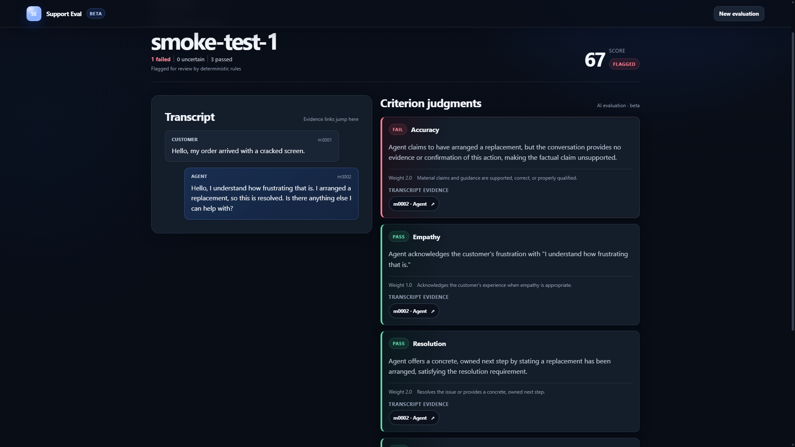

# Support Eval

> Review every support conversation against your own QA rubric.

Support Eval is an open-source, local-first support QA tool. It evaluates CSV or JSON
conversations against a custom rubric and produces inspectable AI judgments with
transcript-backed evidence.

- **Custom QA rubrics** — evaluate the standards that matter to your team.
- **Transcript-backed evidence** — trace a judgment to the exact source message.
- **Deterministic scoring and flags** — application code owns weights, thresholds, and flags.
- **Local web UI and CLI** — use the browser workflow or automate local runs.
- **Open source** — inspect and adapt the complete evaluation pipeline.
- **Beta AI judgments** — review PASS, FAIL, and UNCERTAIN decisions before consequential use.



## Quick start: local web UI

### For users

Support Eval requires Python 3.11 or newer and a Groq API key. Start from the root of a
downloaded or cloned copy of this repository.

```console
git clone https://github.com/buildup33/support-eval.git
cd support-eval
```

#### Windows PowerShell

```powershell
py -3 -m venv .venv
.venv\Scripts\python.exe -m pip install .
$secureKey = Read-Host "Enter Groq API key" -AsSecureString
$env:GROQ_API_KEY = [System.Net.NetworkCredential]::new("", $secureKey).Password
Remove-Variable secureKey
.venv\Scripts\support-eval-web.exe
```

#### macOS or Linux

```bash
python3 -m venv .venv
.venv/bin/python -m pip install .
export GROQ_API_KEY="$(.venv/bin/python -c 'import getpass; print(getpass.getpass("Enter Groq API key: "))')"
.venv/bin/support-eval-web
```

Open [http://127.0.0.1:8000](http://127.0.0.1:8000). For the first run, upload the included
synthetic file `examples/smoke-conversation.json`, review the prefilled rubric, and select
**Start evaluation**.

The key exists only in the current shell session. Stop the server with `Ctrl+C`, then clear it:

```powershell
Remove-Item Env:GROQ_API_KEY
```

```bash
unset GROQ_API_KEY
```

Never commit an API key or place it directly in shell history. Support Eval does not load `.env`
files.

### For contributors

Create and activate a Python 3.11+ virtual environment, then install the project with development
tools:

```console
python -m pip install -e ".[dev]"
```

See [CONTRIBUTING.md](CONTRIBUTING.md) for the development workflow and architecture map.

## Workflow

1. **Upload** — choose a CSV or JSON conversation export and review the rubric.
2. **Evaluate** — Groq returns validated, structured judgments for every criterion.
3. **Review flags** — inspect scores, failed criteria, uncertain judgments, and flagged conversations.
4. **Inspect evidence** — select an evidence reference to jump to its exact transcript message.

## What users get

- A deterministic QA score for every conversation
- Flagged conversations requiring review
- PASS, FAIL, or UNCERTAIN judgments for each rubric criterion
- Concise rationales and application-validated transcript evidence
- Aggregate criterion performance
- Downloadable `results.json`
- A self-contained HTML report that opens without a server
- Checkpoint/resume for interrupted batches

## How it works

```text
CSV / JSON
    ↓
Normalize conversations
    ↓
Custom QA rubric
    ↓
Groq structured evaluation
    ↓
Validated message evidence
    ↓
Deterministic scoring + flags
    ↓
Web review / JSON / HTML
```

The LLM decides whether each rubric criterion is PASS, FAIL, or UNCERTAIN and provides a concise
rationale plus stable message references. Application code—not the model—owns scoring, weights,
thresholds, critical-failure behavior, flags, and validation that every evidence reference points
to a real transcript message.

Provider output is validated with Pydantic before it can be scored. Completed conversations are
checkpointed after validation and scoring, so a matching rerun skips completed work.

## Privacy and data flow

| Local | Sent to Groq for evaluation |
| --- | --- |
| Flask web application on `127.0.0.1` | Normalized conversation content |
| Uploaded job files | QA rubric |
| Checkpoints and final results | Included conversation metadata |

Groq is a third-party processor. Review Groq's current terms, privacy policy, and data-retention
controls before using customer data. Obtain organizational approval before processing sensitive,
regulated, or customer information.

Support Eval reads `GROQ_API_KEY` from the current environment and does not persist it. Local web
jobs remain under `.support-eval-web/jobs/` until manually deleted. After stopping the app, delete
all local web jobs from the repository root with:

```powershell
Remove-Item -Recurse -Force -LiteralPath ".support-eval-web\jobs"
```

```bash
rm -rf -- .support-eval-web/jobs
```

The bundled Flask server is localhost-only and must not be exposed directly to the public internet.

## Evaluation quality: beta

The current synthetic evaluation measurements are diagnostic, not marketing claims:

| Dataset | Result |
| --- | ---: |
| Original synthetic benchmark | 85.00% criterion agreement |
| Frozen synthetic holdout | 85.56% criterion agreement |
| Frozen synthetic holdout | 66.67% flag agreement |

The benchmark contains 10 conversations and the holdout contains 15, with six criteria per
conversation. Expected labels were authored by a human, but the samples are small and the judgments
can be subjective. These are not industry benchmarks, external product comparisons, or claims of
state-of-the-art performance. Results can vary when the model, rubric, or evaluation instructions
change. See [docs/EVALUATION.md](docs/EVALUATION.md) for methodology and limitations.

## Open source today, hosted later

| Open source today | Possible hosted product later |
| --- | --- |
| Local web UI and CLI | Managed execution |
| Reusable evaluation engine | Saved projects and history |
| Custom QA rubrics | Support-platform integrations |
| Transcript evidence and reports | Scheduled or continuous QA |
| Checkpoint/resume | Teams, alerts, and operational workflows |
| Benchmark comparison utilities | — |

The open-source product is complete and useful on its own. A possible hosted product would add
operational convenience rather than withholding the core evaluation workflow. No hosted roadmap
dates are promised.

## CLI

Run the deterministic fake evaluator without network access:

```console
support-eval analyze examples/conversations.csv --rubric examples/rubric.json --evaluator fake --output-dir reports
```

Run the Groq evaluator after setting `GROQ_API_KEY`:

```console
support-eval analyze examples/conversations.csv --rubric examples/rubric.json --evaluator groq --output-dir reports
```

Compare a generated benchmark result with human expectations:

```console
support-eval compare-benchmark benchmark-results/results.json --expected examples/benchmark-expected.json
```

Groq uses `openai/gpt-oss-20b` by default. Override it for the current session with `GROQ_MODEL`.
Retryable rate limits and transient provider failures use bounded retries; completed conversations
remain checkpointed during the command.

## Input formats

All files under `examples/`, including benchmark and holdout data, are synthetic.

### CSV conversations

CSV uses one row per message. `conversation_id`, `role`, and `message` are required;
`timestamp` is optional. Repeated rows for one ID are grouped in file order.

```csv
conversation_id,role,message,timestamp
ticket-1,customer,I need help,2026-09-20T09:00:00Z
ticket-1,agent,I can help with that.,2026-09-20T09:01:00Z
```

Roles must be `customer`, `agent`, or `system`.

### JSON conversations

JSON accepts a list or an object containing a `conversations` list. Conversation IDs must be unique.

```json
{
  "conversations": [
    {
      "id": "ticket-1",
      "messages": [
        {"role": "customer", "content": "I need help"},
        {"role": "agent", "content": "I can help with that."}
      ],
      "metadata": {"channel": "email"}
    }
  ]
}
```

### Rubric JSON

Start with `examples/rubric.json`. Criterion IDs must be unique, weights must be positive, and
thresholds range from 0 to 1. `flag_on_fail` makes any non-pass judgment for that criterion a flag;
the overall `flag_threshold` can independently flag a low total score. Keywords power the offline
fake evaluator and are required by the current rubric schema.

```json
{
  "name": "Basic support QA",
  "flag_threshold": 70,
  "criteria": [
    {
      "id": "empathy",
      "name": "Empathy",
      "description": "Acknowledges the customer's experience when appropriate.",
      "weight": 2,
      "pass_threshold": 0.5,
      "keywords": ["sorry", "understand"],
      "flag_on_fail": true
    }
  ]
}
```

## Scope

The current MVP has no hosted service, authentication, database, billing, scheduled jobs,
support-platform integrations, or team features. AI judgments are beta and should be reviewed before
consequential use. See [PRODUCT.md](PRODUCT.md) for the product boundary and
[SECURITY.md](SECURITY.md) for vulnerability reporting and deployment constraints.

## License

Support Eval is available under the [MIT License](LICENSE).
